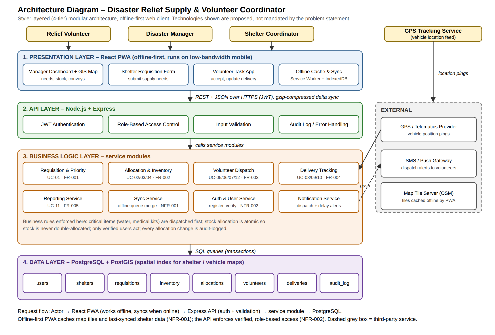

# MyProject_DisasterRelief – Disaster Relief Supply & Volunteer Coordinator

**Student:** Ruthik | **SRN:** PES1UG25CS837 | **Section:** H | **Faculty:** Ambika K  
**Course:** Software Engineering, PES University, Dept. of CSE | **Problem Statement:** #64 – Sustainability & Green Tech

## Problem Statement
An emergency disaster management platform mapping critical shelter supply needs (water, blankets, medical kits), dispatching volunteer skill sets, and tracking relief vehicle deliveries.

**Actors:** Relief Volunteer, Disaster Manager (official). Shelter Coordinator and GPS Tracking Service are added in the Lab 1 diagram.

## Repository Structure
| Folder | Contents | Status |
|---|---|---|
| [1_RE](1_RE/) | Requirements table (5 FR + 2 NFR), RTM, UML use-case diagram, use-case flow specification | Done |
| [2_Architectural_Diagram](2_Architectural_Diagram/) | Layered architecture diagram | Done |
| [3_Screenshots_GitHub_Jira](3_Screenshots_GitHub_Jira/) | Lab 2 Kanban, Scrum, Bug Tracking reports + GitHub/Jira screenshots | Done |
| [4_SRS_and_WBS](4_SRS_and_WBS/) | SRS and Work Breakdown Structure | Done |
| [5_GitHub_Copilot_Code](5_GitHub_Copilot_Code/) | Copilot-generated code, passing tests, Copilot prompts | Done |
| [6_Software_Testing_Tools](6_Software_Testing_Tools/) | Bug fix and retest of the shared game application | Done |

